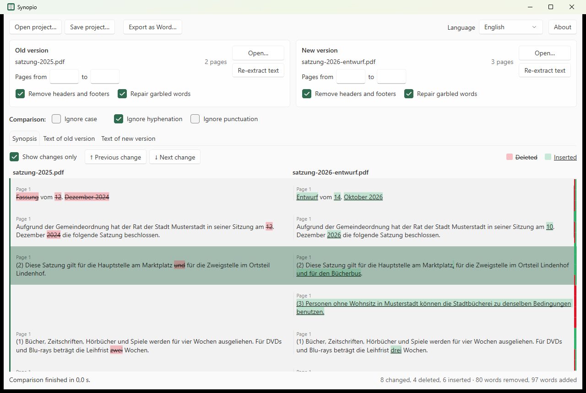
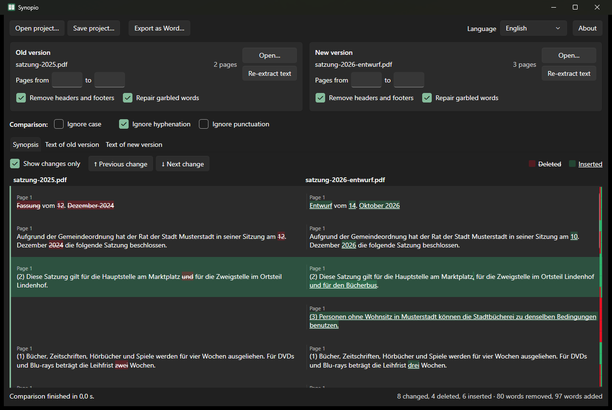

#  Synopio

<!-- web:skip -->
[English](#english) · [Deutsch](#deutsch)
<!-- /web:skip -->

## English

A Windows app that compares two versions of a document and shows the differences side by side as a synopsis: deleted text is struck through on the left, inserted text is underlined on the right.
It is made for drafts of laws, ordinances, reports and other long documents, where layout, line breaks and hyphenation differ between the versions while the content barely changes.

> **Work in progress:** Synopio is at an early stage of development. Features, file formats and the user interface may still change.

> Feedback and bug reports are welcome as [issues](../../issues). Not affiliated with or endorsed by Microsoft. Windows and Word are trademarks of the Microsoft group of companies.

<p>
  
  
</p>

### Features
- Compares PDF, Word (DOCX), text and Markdown files, also across formats; Markdown is compared as plain text
- Removes running headers, footers and page numbers and joins hyphenated words, so layout differences are not reported as changes
- Repairs garbled words such as `Situa=on` that some PDFs contain instead of `Situation` (see [Repairing garbled words](#repairing-garbled-words))
- Compares only a page range, for example a report that is part of a larger attachment
- Lets you correct the extracted text by hand without changing the original files
- Marks the changes next to the scroll bar and jumps from change to change
- Exports the synopsis as a Word document
- Compares again automatically as soon as a file, a page range, an option or the corrected text changes
- No network access, no telemetry

### Installation
Synopio needs Windows 11 and the [.NET 10 Desktop Runtime](https://dotnet.microsoft.com/download/dotnet/10.0). If the runtime is missing, Windows shows a hint with a download link when Synopio starts, and the installer points it out as well.

Download one of the files from [Releases](../../releases):

- **Installer** `Synopio-<version>-windows-x64-setup.exe` – installs for the current user (default, no administrator rights) or for all users, adds a Start menu entry and optionally opens `.synopio` project files with Synopio. It can be removed under Settings → Apps.
- **Portable** `Synopio-<version>-windows-x64.zip` – extract it to any folder and start `Synopio.exe`. Keep the `lang` folder next to the program.

The program is not signed, so SmartScreen may warn on the first start: "More info" → "Run anyway". Each file has a `.sha256` file to verify the download, and the release notes link a VirusTotal scan. Changes are listed in the [changelog](CHANGELOG.md).

#### Installer parameters
The installer accepts the usual Inno Setup parameters, e.g. for a silent installation:

| Parameter | Effect |
|---|---|
| `/CURRENTUSER` | Install for the current user only (default) |
| `/ALLUSERS` | Install for all users (asks for administrator rights) |
| `/DIR="C:\Path"` | Installation folder |
| `/SILENT`, `/VERYSILENT` | Without wizard (with or without progress window) |
| `/SUPPRESSMSGBOXES` | No message boxes in silent mode |
| `/TASKS="fileassociation,desktopicon"` | Selected options; `fileassociation` opens `.synopio` project files with Synopio, `desktopicon` adds a desktop shortcut. Without the parameter, the file association is on and the desktop shortcut off |
| `/NOICONS` | No Start menu entry |
| `/LOG="C:\Path\setup.log"` | Write a log file |

Example: `Synopio-0.1.0-windows-x64-setup.exe /VERYSILENT /SUPPRESSMSGBOXES /ALLUSERS /TASKS="fileassociation"`

Settings such as the language or the window position are stored per user and are not set by the installer. Uninstalling removes the program and the file association but keeps the settings in `%APPDATA%\Synopio` and `%LOCALAPPDATA%\Synopio`.

### Usage
1. Open the old version on the left and the new version on the right, either with **Open…** or by dropping a file onto the panel.
2. The comparison starts automatically and runs again after every change. **Show changes only** hides unchanged paragraphs, **Previous change** and **Next change** jump between differences. Red and green marks next to the scroll bar show where text was deleted or inserted.
3. To compare only part of a document, enter the page range under **Pages from … to …**.
4. **Export as Word…** saves the synopsis as a two-column table in landscape format. If **Show changes only** is active, only changed rows are exported.
5. **Save project…** stores the files, page ranges, options and manual corrections in a `.synopio` file, so a comparison can be continued later. A project file can also be opened by passing it to `Synopio.exe`.

If the text of a PDF was extracted incorrectly, correct it on the tabs **Text of old version** and **Text of new version**. Paragraphs are separated by a blank line, a line such as `[[12]]` marks the start of page 12. The synopsis uses the corrected text, the original file stays unchanged. **Re-extract text** discards the corrections.

| Option | Effect |
|---|---|
| Ignore case | `Satzung` and `SATZUNG` count as equal |
| Ignore hyphenation | `nordrhein-westfälisch` and `nordrheinwestfälisch` count as equal (on by default) |
| Ignore punctuation | Commas, periods and other punctuation marks are not compared |
| Remove headers and footers | Lines that repeat at the top or bottom of many pages, and page numbers, are removed |
| Repair garbled words | See [Repairing garbled words](#repairing-garbled-words) |

#### Repairing garbled words
Many fonts draw certain letter pairs such as `fi`, `ft`, `tt` or `ti` as one combined character, a so-called ligature. Some programs store these characters incorrectly when creating a PDF, so the extracted text contains `Situa=on` instead of `Situation` or `Au>rag` instead of `Auftrag`. Synopio recognizes such words, tries the usual letter pairs and keeps the one that results in a word occurring correctly in one of the two documents. It only changes a word if such a match exists.

Selected synopsis rows can be copied with `Ctrl+C`. **About** shows the version and the license and links to the project page. The Word export names Synopio and the version in the footer.

Synopio follows the light or dark mode of Windows and remembers the window size and position; if the screen it was on is no longer connected, it opens centered.

#### Languages
Synopio is available in English and German. With **Automatic**, it follows the Windows display language and falls back to English; [LANGUAGES.md](LANGUAGES.md) lists all languages.

The translations were generated by Claude (AI). If you notice a mistake or know a better wording, please open an [issue](../../issues) or a pull request. The texts are plain text files in the [`lang`](lang) folder, one `key = text` per line. Language files are read from the `lang` folder next to the program and from `%APPDATA%\Synopio\lang`; texts in the second folder take priority.

### How it works
1. **Reading:** PDF text is read with its position on the page using [PdfPig](https://github.com/UglyToad/PdfPig). DOCX files are read directly from the document XML, text and Markdown files line by line.
2. **Preparing:** Lines that repeat at the same place on many pages are removed as headers and footers. Garbled words are repaired with words that occur correctly in the same or the other document. Lines are joined into paragraphs using their spacing and markers such as `§`, `(1)` or `a)`, and hyphenated words are joined again.
3. **Comparing:** Both texts are split into words and punctuation marks. A difference algorithm first matches words that occur only once in both texts and then refines the gaps between them. Single matching words inside largely rewritten passages are discarded so that rewritten text appears as one block, and deleted or inserted blocks are aligned to paragraph boundaries. Typographic quotation marks and dashes count as equal to their simple forms.
4. **Synopsis:** Paragraphs that share matching words are placed in one row, so a paragraph split into two still appears as one unchanged row. Paragraphs without a counterpart become rows that are only deleted or only inserted.

### Privacy
- Synopio does not access the network. Nothing is downloaded or sent. The links under **About** open in the browser only when clicked.
- Documents are only read, Synopio never changes them.
- The selected language is stored in `%APPDATA%\Synopio\settings.json`, the window size and position in `%LOCALAPPDATA%\Synopio\window.json`.
- Project files (`.synopio`) contain the paths of the compared files relative to the project file, their SHA-256 checksums, the page ranges, the options and, if present, the corrected text. Keep this in mind before passing on a project file.

<!-- web:skip -->

### Building
Synopio is written in C# with WPF and .NET 10 and only depends on [PdfPig](https://github.com/UglyToad/PdfPig) for reading PDF files.

```
dotnet build Synopio.slnx -c Release
dotnet test --project Synopio.Engine.Tests
dotnet publish Synopio/Synopio.csproj -c Release -r win-x64 --self-contained false -p:PublishSingleFile=true -o publish
```

The solution consists of three projects:

- `Synopio` – the Windows app (WPF, MVVM)
- `Synopio.Engine` – reading, preparing and comparing documents and the Word export, without any user interface
- `Synopio.Engine.Tests` – tests for `Synopio.Engine`, also with the documents in [`testdata`](testdata)

The version is set once in [`Directory.Build.props`](Directory.Build.props). A release is created automatically when a new version reaches `main`. Each version needs a section with English and German notes in [CHANGELOG.md](CHANGELOG.md), which becomes the release notes; tests and pipeline fail without it.

`scripts/ThirdPartyLicenses.ps1` collects the licenses of all third-party components into `THIRD-PARTY-LICENSES.txt` for the release packages and fails if a component uses a license that is not on its allow list. License texts that a package does not contain itself are stored in [`licenses`](licenses).

The folder [`testdata`](testdata) contains fictional test documents in all supported formats, which the tests use and which are suitable for trying out Synopio. The screenshots show the two PDF versions from there.

The icons in [`assets/icons`](assets/icons) (ICO and PNG in all common sizes) are generated from `icon.svg` with [`render-icons.mjs`](https://github.com/TripleT3005/TripleT3005/blob/main/scripts/render-icons.mjs), which needs Node.js and Edge or Chrome: `node render-icons.mjs assets/icons`.

[LANGUAGES.md](LANGUAGES.md) is generated from the headers of the language files. After changing them, run `$env:UPDATE_LANGUAGES = 1; dotnet test --project Synopio.Engine.Tests`; the tests fail if it is out of date.

<!-- /web:skip -->

### License
[MIT](LICENSE)

Release packages and the installer include `THIRD-PARTY-LICENSES.txt` with the licenses of all third-party components built into Synopio.

## Deutsch

Eine Windows-App, die zwei Fassungen eines Dokuments vergleicht und die Unterschiede nebeneinander als Synopse zeigt: Gelöschtes steht links durchgestrichen, Eingefügtes rechts unterstrichen.
Gedacht ist sie für Entwürfe von Gesetzen, Verordnungen, Berichten und andere lange Dokumente, bei denen sich Layout, Zeilenumbrüche und Silbentrennung zwischen den Fassungen unterscheiden, der Inhalt aber kaum.

> **Work in progress:** Synopio steht noch am Anfang der Entwicklung. Funktionen, Dateiformate und Oberfläche können sich noch ändern.

> Rückmeldungen und Fehlerberichte gern als [Issue](../../issues). Keine Verbindung zu Microsoft und nicht von Microsoft unterstützt. Windows und Word sind Marken der Microsoft-Unternehmensgruppe.

<p>
  
  
</p>

### Funktionen
- Vergleicht PDF-, Word- (DOCX), Text- und Markdown-Dateien, auch untereinander; Markdown wird als reiner Text verglichen
- Entfernt wiederkehrende Kopf- und Fußzeilen sowie Seitenzahlen und verbindet getrennte Wörter, damit Layoutunterschiede nicht als Änderungen erscheinen
- Repariert verstümmelte Wörter wie `Situa=on`, die manche PDFs statt `Situation` enthalten (siehe [Verstümmelte Wörter reparieren](#verstümmelte-wörter-reparieren))
- Vergleicht auf Wunsch nur einen Seitenbereich, zum Beispiel einen Bericht, der Teil einer größeren Anlage ist
- Der ausgelesene Text lässt sich von Hand korrigieren, ohne die Originaldateien zu verändern
- Markiert die Änderungen neben dem Scrollbalken und springt von Änderung zu Änderung
- Exportiert die Synopse als Word-Dokument
- Vergleicht automatisch neu, sobald sich eine Datei, ein Seitenbereich, eine Option oder der korrigierte Text ändert
- Kein Netzwerkzugriff, keine Telemetrie

### Installation
Synopio benötigt Windows 11 und die [.NET 10 Desktop Runtime](https://dotnet.microsoft.com/download/dotnet/10.0). Fehlt die Runtime, zeigt Windows beim Start von Synopio einen Hinweis mit Download-Link, und auch der Installer weist darauf hin.

Eine der Dateien unter [Releases](../../releases) herunterladen:

- **Installer** `Synopio-<Version>-windows-x64-setup.exe` – installiert für den aktuellen Benutzer (Standard, ohne Administratorrechte) oder für alle Benutzer, legt einen Startmenü-Eintrag an und öffnet auf Wunsch `.synopio`-Projektdateien mit Synopio. Entfernen lässt es sich unter Einstellungen → Apps.
- **Portabel** `Synopio-<Version>-windows-x64.zip` – in einen beliebigen Ordner entpacken und `Synopio.exe` starten. Den Ordner `lang` neben dem Programm lassen.

Das Programm ist nicht signiert, daher kann SmartScreen beim ersten Start warnen: „Weitere Informationen“ → „Trotzdem ausführen“. Zu jeder Datei gibt es eine `.sha256`-Datei zum Prüfen des Downloads, und die Release-Notizen verlinken einen VirusTotal-Scan. Änderungen stehen im [Changelog](CHANGELOG.md).

#### Installer-Parameter
Der Installer kennt die üblichen Inno-Setup-Parameter, z. B. für eine stille Installation:

| Parameter | Wirkung |
|---|---|
| `/CURRENTUSER` | Nur für den aktuellen Benutzer installieren (Standard) |
| `/ALLUSERS` | Für alle Benutzer installieren (fragt nach Administratorrechten) |
| `/DIR="C:\Pfad"` | Installationsordner |
| `/SILENT`, `/VERYSILENT` | Ohne Assistent (mit oder ohne Fortschrittsfenster) |
| `/SUPPRESSMSGBOXES` | Keine Meldungsfenster im stillen Modus |
| `/TASKS="fileassociation,desktopicon"` | Gewählte Optionen; `fileassociation` öffnet `.synopio`-Projektdateien mit Synopio, `desktopicon` legt eine Desktop-Verknüpfung an. Ohne den Parameter ist die Verknüpfung der Dateien an und die Desktop-Verknüpfung aus |
| `/NOICONS` | Kein Startmenü-Eintrag |
| `/LOG="C:\Pfad\setup.log"` | Protokolldatei schreiben |

Beispiel: `Synopio-0.1.0-windows-x64-setup.exe /VERYSILENT /SUPPRESSMSGBOXES /ALLUSERS /TASKS="fileassociation"`

Einstellungen wie die Sprache oder die Fensterposition gelten pro Benutzer und werden nicht über den Installer gesetzt. Die Deinstallation entfernt Programm und Dateiverknüpfung, lässt aber die Einstellungen in `%APPDATA%\Synopio` und `%LOCALAPPDATA%\Synopio` stehen.

### Bedienung
1. Links die alte und rechts die neue Fassung öffnen, entweder mit **Öffnen …** oder indem man eine Datei auf den Bereich zieht.
2. Der Vergleich startet automatisch und läuft nach jeder Änderung erneut. **Nur Änderungen anzeigen** blendet unveränderte Absätze aus, **Vorherige Änderung** und **Nächste Änderung** springen zwischen den Unterschieden. Rote und grüne Markierungen neben dem Scrollbalken zeigen, wo Text gelöscht oder eingefügt wurde.
3. Soll nur ein Teil eines Dokuments verglichen werden, den Seitenbereich unter **Seiten von … bis …** eintragen.
4. **Als Word exportieren …** speichert die Synopse als zweispaltige Tabelle im Querformat. Ist **Nur Änderungen anzeigen** aktiv, werden nur geänderte Zeilen exportiert.
5. **Projekt speichern …** legt Dateien, Seitenbereiche, Optionen und manuelle Korrekturen in einer `.synopio`-Datei ab, sodass ein Vergleich später weitergeführt werden kann. Eine Projektdatei lässt sich auch öffnen, indem man sie an `Synopio.exe` übergibt.

Wurde der Text eines PDFs falsch ausgelesen, lässt er sich auf den Reitern **Text alte Fassung** und **Text neue Fassung** korrigieren. Absätze werden durch eine Leerzeile getrennt, eine Zeile wie `[[12]]` markiert den Beginn von Seite 12. Die Synopse verwendet den korrigierten Text, die Originaldatei bleibt unverändert. **Text neu auslesen** verwirft die Korrekturen.

| Option | Wirkung |
|---|---|
| Groß-/Kleinschreibung ignorieren | `Satzung` und `SATZUNG` gelten als gleich |
| Silbentrennung ignorieren | `nordrhein-westfälisch` und `nordrheinwestfälisch` gelten als gleich (standardmäßig an) |
| Satzzeichen ignorieren | Kommas, Punkte und andere Satzzeichen werden nicht verglichen |
| Kopf- und Fußzeilen entfernen | Zeilen, die sich oben oder unten auf vielen Seiten wiederholen, und Seitenzahlen werden entfernt |
| Verstümmelte Wörter reparieren | Siehe [Verstümmelte Wörter reparieren](#verstümmelte-wörter-reparieren) |

#### Verstümmelte Wörter reparieren
Viele Schriften stellen bestimmte Buchstabenpaare wie `fi`, `ft`, `tt` oder `ti` als ein zusammengezogenes Zeichen dar, eine sogenannte Ligatur. Manche Programme speichern diese Zeichen beim Erzeugen eines PDFs fehlerhaft, sodass im ausgelesenen Text `Situa=on` statt `Situation` oder `Au>rag` statt `Auftrag` steht. Synopio erkennt solche Wörter, probiert die üblichen Buchstabenpaare aus und übernimmt das Paar, mit dem ein Wort entsteht, das in einem der beiden Dokumente korrekt vorkommt. Ein Wort wird nur geändert, wenn es eine solche Übereinstimmung gibt.

Markierte Zeilen der Synopse lassen sich mit `Strg+C` kopieren. **Info** zeigt Version und Lizenz und verlinkt die Projektseite. Der Word-Export nennt Synopio und die Version in der Fußzeile.

Synopio folgt dem hellen oder dunklen Modus von Windows und merkt sich Fenstergröße und -position; ist der Bildschirm, auf dem es zuletzt lag, nicht mehr angeschlossen, öffnet es mittig.

#### Sprachen
Synopio gibt es auf Englisch und Deutsch. Mit **Automatisch** richtet es sich nach der Anzeigesprache von Windows und fällt sonst auf Englisch zurück; [LANGUAGES.md](LANGUAGES.md) listet alle Sprachen.

Die Übersetzungen wurden von Claude (KI) erzeugt. Wenn dir ein Fehler auffällt oder du eine bessere Formulierung kennst, eröffne gern ein [Issue](../../issues) oder einen Pull Request. Die Texte sind einfache Textdateien im Ordner [`lang`](lang), eine Zeile `Schlüssel = Text` je Text. Sprachdateien werden aus dem Ordner `lang` neben dem Programm und aus `%APPDATA%\Synopio\lang` gelesen; Texte im zweiten Ordner haben Vorrang.

### Funktionsweise
1. **Einlesen:** Der Text von PDFs wird mit seiner Position auf der Seite gelesen, mit [PdfPig](https://github.com/UglyToad/PdfPig). DOCX-Dateien werden direkt aus dem Dokument-XML gelesen, Text- und Markdown-Dateien zeilenweise.
2. **Aufbereiten:** Zeilen, die auf vielen Seiten an derselben Stelle wiederkehren, werden als Kopf- und Fußzeilen entfernt. Verstümmelte Wörter werden anhand von Wörtern repariert, die im selben oder im anderen Dokument korrekt vorkommen. Zeilen werden anhand ihrer Abstände und von Gliederungszeichen wie `§`, `(1)` oder `a)` zu Absätzen zusammengesetzt, getrennte Wörter wieder verbunden.
3. **Vergleichen:** Beide Texte werden in Wörter und Satzzeichen zerlegt. Ein Differenzalgorithmus ordnet zuerst Wörter zu, die in beiden Texten nur einmal vorkommen, und verfeinert dann die Lücken dazwischen. Einzelne übereinstimmende Wörter in weitgehend umgeschriebenen Passagen werden verworfen, damit neu formulierter Text als ein Block erscheint, und gelöschte oder eingefügte Blöcke werden an Absatzgrenzen ausgerichtet. Typografische Anführungszeichen und Striche gelten als gleich mit ihren einfachen Formen.
4. **Synopse:** Absätze mit übereinstimmenden Wörtern kommen in eine Zeile, ein in zwei Absätze aufgeteilter Absatz erscheint also weiterhin als eine unveränderte Zeile. Absätze ohne Gegenstück werden zu Zeilen, die nur gelöscht oder nur eingefügt sind.

### Datenschutz
- Synopio greift nicht auf das Netzwerk zu. Es wird nichts abgerufen und nichts gesendet. Die Links unter **Info** öffnen sich nur beim Anklicken im Browser.
- Dokumente werden nur gelesen, Synopio verändert sie nie.
- Die gewählte Sprache wird in `%APPDATA%\Synopio\settings.json` gespeichert, Fenstergröße und -position in `%LOCALAPPDATA%\Synopio\window.json`.
- Projektdateien (`.synopio`) enthalten die Pfade der verglichenen Dateien relativ zur Projektdatei, deren SHA-256-Prüfsummen, die Seitenbereiche, die Optionen und, falls vorhanden, den korrigierten Text. Das sollte man bedenken, bevor man eine Projektdatei weitergibt.

<!-- web:skip -->

### Bauen
Synopio ist in C# mit WPF und .NET 10 geschrieben und hängt nur von [PdfPig](https://github.com/UglyToad/PdfPig) zum Lesen von PDF-Dateien ab.

```
dotnet build Synopio.slnx -c Release
dotnet test --project Synopio.Engine.Tests
dotnet publish Synopio/Synopio.csproj -c Release -r win-x64 --self-contained false -p:PublishSingleFile=true -o publish
```

Die Projektmappe besteht aus drei Projekten:

- `Synopio` – die Windows-App (WPF, MVVM)
- `Synopio.Engine` – Einlesen, Aufbereiten und Vergleichen der Dokumente sowie der Word-Export, ohne Oberfläche
- `Synopio.Engine.Tests` – Tests für `Synopio.Engine`, auch mit den Dokumenten in [`testdata`](testdata)

Die Version steht einmalig in [`Directory.Build.props`](Directory.Build.props). Ein Release entsteht automatisch, sobald eine neue Version auf `main` landet. Jede Version braucht in [CHANGELOG.md](CHANGELOG.md) einen Abschnitt mit englischen und deutschen Notizen, der zu den Release-Notizen wird; ohne ihn schlagen Tests und Pipeline fehl.

`scripts/ThirdPartyLicenses.ps1` sammelt die Lizenzen aller Fremdkomponenten in `THIRD-PARTY-LICENSES.txt` für die Release-Pakete und schlägt fehl, wenn eine Komponente eine Lizenz nutzt, die nicht auf der erlaubten Liste steht. Lizenztexte, die ein Paket nicht selbst enthält, liegen in [`licenses`](licenses).

Der Ordner [`testdata`](testdata) enthält erfundene Testdokumente in allen unterstützten Formaten, die die Tests nutzen und die sich zum Ausprobieren von Synopio eignen. Die Screenshots zeigen die beiden PDF-Fassungen von dort.

Die Icons in [`assets/icons`](assets/icons) (ICO und PNG in allen gängigen Größen) werden mit [`render-icons.mjs`](https://github.com/TripleT3005/TripleT3005/blob/main/scripts/render-icons.mjs) aus `icon.svg` erzeugt; das Skript braucht Node.js und Edge oder Chrome: `node render-icons.mjs assets/icons`.

[LANGUAGES.md](LANGUAGES.md) wird aus den Köpfen der Sprachdateien erzeugt. Nach Änderungen daran `$env:UPDATE_LANGUAGES = 1; dotnet test --project Synopio.Engine.Tests` ausführen; die Tests schlagen fehl, wenn sie veraltet ist.

<!-- /web:skip -->

### Lizenz
[MIT](LICENSE)

Release-Pakete und Installer enthalten `THIRD-PARTY-LICENSES.txt` mit den Lizenzen aller in Synopio eingebauten Fremdkomponenten.
